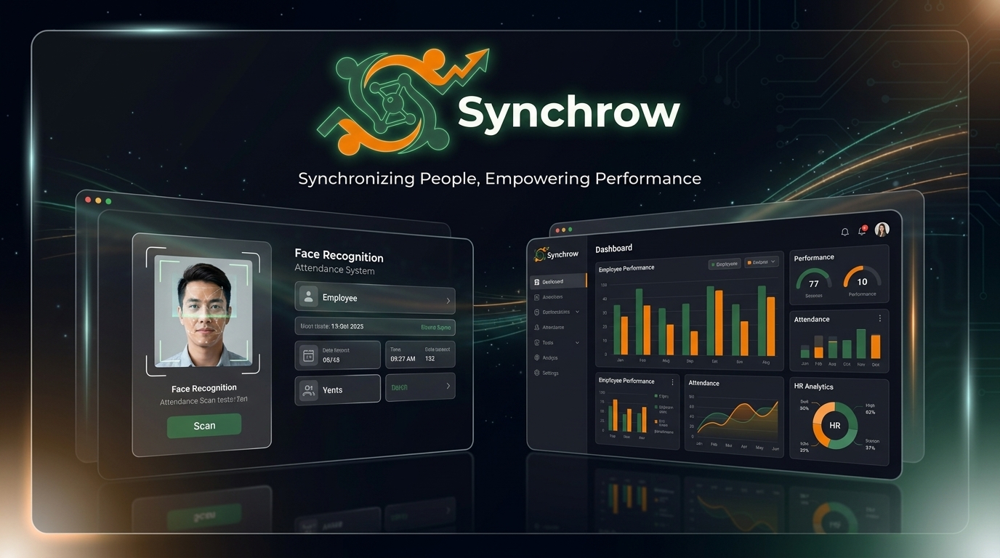

<div align="center">
  
  
  <br />
  <br />

  # Synchrow 
  **Next-Generation Enterprise HRIS Platform**

  <p>
    An intelligent, scalable, and modern Human Resource Information System with Face Recognition, Payroll Management, and automated ESS (Employee Self-Service).
  </p>

  []()
  []()
  []()
  []()
</div>

---

> ⚠️ **Notice**: This application is currently in **active development**. Features and APIs are subject to change. Do not use in production without proper testing.

## 🌟 Overview

**Synchrow** is a modern Enterprise HRIS frontend designed for maximum information density, usability, and visual elegance. Built with **Next.js 15 App Router** and **Tailwind CSS v4**, it provides HR professionals and employees with a seamless, "Silent Partner" experience to manage human capital effectively.

## ✨ Core Features (WIP)

- 🔐 **Role-Based Access Control (RBAC)**: Secure multi-tier routing (Super Admin, HR, Employee).
- 🧑‍💻 **Employee Self-Service (ESS)**: Empower employees to view their own attendance, request leaves, and download payslips.
- 🕒 **Face Recognition Attendance**: Check-in and check-out tracking integrated with WebRTC and AI face validation.
- 💰 **Payroll Management**: Generate, view, and distribute detailed salary slips dynamically.
- 🏖️ **Leave Management**: Submit, approve, and track time-off requests with real-time status updates.
- 📊 **Insightful Dashboard**: Get an overview of daily attendance, late check-ins, and active leaves at a glance.

## 🛠️ Tech Stack

- **Framework**: [Next.js 15](https://nextjs.org/) (App Router)
- **Styling**: [Tailwind CSS v4](https://tailwindcss.com/)
- **Language**: [TypeScript](https://www.typescriptlang.org/)
- **State Management**: [Zustand](https://github.com/pmndrs/zustand)
- **Data Fetching**: [Axios](https://axios-http.com/)
- **UI Components**: [Shadcn UI](https://ui.shadcn.com/) / Radix Primitives
- **Icons**: [Material Symbols](https://fonts.google.com/icons)

## 🚀 Getting Started

### Prerequisites
Make sure you have [Node.js](https://nodejs.org/) (v18+) and npm installed. You will also need the backend API running locally.

### Installation

1. Clone the repository:
   ```bash
   git clone https://github.com/yourusername/synchrow-frontend.git
   cd synchrow-frontend
   ```

2. Install dependencies:
   ```bash
   npm install
   ```

3. Configure Environment Variables:
   Create a `.env.local` file in the root directory and add your API endpoint:
   ```env
   NEXT_PUBLIC_API_URL=http://localhost:8000/api
   ```

4. Run the development server:
   ```bash
   npm run dev
   ```

5. Open [http://localhost:3000](http://localhost:3000) with your browser to see the result.

## 🎨 Design System

Synchrow uses a custom **"Corporate Modern"** design system:
- **Primary**: Deep Olive (`#2E2910`)
- **Secondary**: Emerald Green (`#2C5745`)
- **Accent**: Soft Beige (`#EBE3A7`)
- **Highlight**: Warm Orange (`#EB7D00`)

The UI is built with a focus on fluid layouts, tonal depth (glassmorphism/ambient shadows), and high-contrast typography using Inter.

## 📜 License

This project is licensed under the MIT License - see the [LICENSE](LICENSE) file for details.
